# 🛡️ Phishing Email Detection & Awareness Dashboard

A defensive cybersecurity application built with **Python and Streamlit** for analyzing email security indicators, detecting potential phishing attempts, generating explainable risk assessments, and improving cybersecurity awareness.

The system combines **sender analysis, NLP-based content analysis, URL inspection, attachment analysis, rule-based risk scoring, interactive analytics, analysis history, and security-awareness guidance** in a single dashboard.

> **Security & Educational Disclaimer:** This project is designed strictly for defensive cybersecurity education and demonstration. It uses synthetic/sample email data and safe fictional URLs. It does not visit suspicious URLs, execute attachments, collect credentials, or perform offensive security activities.

---

## 📌 Overview

Phishing attacks frequently use social-engineering techniques such as urgency, threats, credential requests, suspicious links, financial requests, and malicious-looking attachments.

This project provides an explainable phishing-risk assessment workflow that evaluates these indicators and produces:

* Phishing risk score
* Risk classification
* Detected indicators
* Security recommendations
* URL analysis
* Attachment analysis
* Sender analysis
* Interactive dashboard analytics
* Email analysis history
* Cybersecurity awareness guidance

The application is implemented as a **Streamlit dashboard** for fast local deployment and demonstration.

---

## 🎯 Problem Statement

Phishing emails can appear legitimate while using psychological manipulation and technical indicators to convince users to click links, open attachments, or disclose sensitive information.

Traditional email inspection can be difficult for non-security users because suspicious characteristics may be distributed across:

* Sender address
* Sender domain
* Email subject
* Email body
* URLs
* Attachments
* Urgency and threat language
* Credential requests
* Financial requests

This project addresses the problem by providing an **explainable, defensive phishing-risk analysis system** that highlights suspicious indicators rather than simply returning a black-box prediction.

---

## 🎯 Objectives

1. Analyze email sender information and domains.
2. Detect suspicious phishing-related language.
3. Identify urgency and social-engineering indicators.
4. Analyze URLs using static inspection.
5. Detect suspicious or dangerous attachment extensions.
6. Calculate an explainable phishing risk score.
7. Classify emails into risk categories.
8. Provide actionable security recommendations.
9. Visualize synthetic phishing and legitimate email data.
10. Provide cybersecurity awareness education.
11. Maintain analysis history during application use.
12. Provide a professional interactive security dashboard.

---

## ✨ Key Features

### 🔍 Email Risk Analyzer

Users can provide:

* Sender email
* Subject
* Email body
* URLs
* Attachment name

The system performs a static security analysis and generates a risk assessment.

### 👤 Sender Analysis

The analyzer checks for:

* Suspicious sender-domain patterns
* Unusually long domains
* Multiple subdomains
* Numeric domain characteristics
* Invalid sender format

### 📝 Email Content Analysis

The system identifies:

* Urgency keywords
* Credential-related keywords
* Financial/payment language
* Threat language
* Generic greetings
* Password requests
* Personal-information requests
* Excessive exclamation marks
* High uppercase ratio

### 🔗 URL Analysis

URLs are inspected without visiting them.

The analyzer checks for:

* HTTP instead of HTTPS
* Raw IP addresses
* URL shorteners
* Suspicious security/action keywords
* `@` symbols
* Unusually long URLs

### 📎 Attachment Analysis

The system identifies potentially dangerous attachment types such as:

* `.exe`
* `.scr`
* `.js`
* `.bat`
* `.cmd`
* `.vbs`
* `.ps1`
* `.jar`

It also detects suspicious double extensions such as:

```text
document.pdf.exe
```

### 📊 Explainable Risk Scoring

The system combines multiple security indicators into a score from:

```text
0 – 100
```

Risk classifications:

|  Score | Classification              |
| -----: | --------------------------- |
|   0–24 | SAFE                        |
|  25–49 | LOW RISK                    |
|  50–69 | SUSPICIOUS                  |
| 70–100 | HIGH RISK / LIKELY PHISHING |

The score is capped at 100.

### 🎓 Security Awareness Center

The dashboard provides educational guidance covering:

* Sender verification
* Domain inspection
* Urgency and manipulation
* Suspicious links
* Credential protection
* Attachment safety
* Payment requests
* Threat-based social engineering
* Before You Click checklist

### 🗂️ Dataset Explorer

Users can:

* Explore the synthetic dataset
* Filter by classification
* Filter by category
* View records
* Download filtered data

### 🕒 Analysis History

The application maintains analysis information including:

* Analysis ID
* Sender domain
* Subject
* Risk score
* Classification
* Detected indicators
* Analysis timestamp

---

# 🧠 Detection Methodology

The project uses a **defensive rule-based risk engine**.

The overall workflow is:

```text
Email Input
     ↓
Sender Analysis
     ↓
Content Analysis
     ↓
URL Analysis
     ↓
Attachment Analysis
     ↓
Indicator Aggregation
     ↓
Risk Score
     ↓
Classification
     ↓
Security Recommendations
```

---

## 📈 Risk Indicators

Examples of indicators include:

```text
Suspicious sender domain
Urgency/manipulation language
Credential-related language
Financial/payment language
Threat language
Password request
Personal information request
Raw IP address
Non-HTTPS URL
Suspicious URL keywords
Dangerous attachment
Double file extension
```

No single indicator automatically guarantees that an email is malicious. The system combines multiple contextual indicators to produce an explainable assessment.

---

# 📂 Dataset

The project uses a **synthetic dataset containing 600 email records**.

Dataset distribution:

| Classification | Records |
| -------------- | ------: |
| Legitimate     |     300 |
| Phishing       |     300 |
| **Total**      | **600** |

Dataset file:

```text
data/phishing_email_dataset.csv
```

### Dataset Fields

```text
email_id
sender
sender_domain
subject
body
urls
attachment_name
label
category
```

The dataset uses fictional/safe domains and sample content for defensive cybersecurity demonstration.

---

# 🛠️ Technology Stack

| Technology          | Purpose                             |
| ------------------- | ----------------------------------- |
| Python              | Core programming language           |
| Streamlit           | Interactive web dashboard           |
| Pandas              | Dataset processing                  |
| NumPy               | Numerical operations                |
| Plotly              | Interactive visualizations          |
| Scikit-learn        | Machine-learning ecosystem support  |
| SQLite              | Local analysis-history storage      |
| Pytest              | Automated testing                   |
| Regular Expressions | Pattern detection                   |
| URL Parsing         | Static URL analysis                 |
| Git/GitHub          | Version control and project hosting |

---

# 📁 Project Structure

```text
Phishing-Email-Detection-Awareness-Dashboard/
│
├── data/
│   ├── phishing_email_dataset.csv
│   └── phishing_analysis.db
│
├── screenshots/
│   ├── screenshot1.png
│   ├── screenshot2.png
│   ├── screenshot3.png
│   ├── screenshot4.png
│   ├── screenshot5.png
│   ├── screenshot6.png
│   ├── screenshot7.png
│   ├── screenshot8.png
│   ├── screenshot9.png
│   ├── screenshot10.png
│   ├── screenshot11.png
│   └── screenshot12.png
│
├── tests/
│   └── test_analyzer.py
│
├── utils/
│   ├── __init__.py
│   ├── analyzer.py
│   └── database.py
│
├── models/
│
├── app.py
├── generate_dataset.py
├── requirements.txt
├── .gitignore
└── README.md
```

---

# ⚙️ Installation

## 1. Clone the Repository

```bash
git clone https://github.com/YOUR_USERNAME/Phishing-Email-Detection-Awareness-Dashboard.git
```

```bash
cd Phishing-Email-Detection-Awareness-Dashboard
```

## 2. Create a Virtual Environment

### Windows

```powershell
python -m venv .venv
```

Activate it:

```powershell
.\.venv\Scripts\Activate.ps1
```

## 3. Install Dependencies

```powershell
pip install -r requirements.txt
```

Install testing dependency:

```powershell
pip install pytest
```

---

# ▶️ Generate the Dataset

Run:

```powershell
python generate_dataset.py
```

Expected output:

```text
Dataset generated successfully!
Total records: 600

Class distribution:
LEGITIMATE    300
PHISHING      300
```

---

# 🚀 Run the Application

Start Streamlit:

```powershell
streamlit run app.py
```

The application will open in your browser.

---

# 🧪 Testing

The project contains automated tests using **Pytest**.

Run:

```powershell
$env:PYTHONPATH="."
pytest -v
```

The current test suite contains:

```text
17 tests
```

Test coverage includes:

* Sender analysis
* URL analysis
* Email content analysis
* Attachment analysis
* Risk classification
* Complete phishing analysis
* Safe email analysis
* URL extraction
* Multiple URL analysis

Current project validation:

```text
17 passed
```

---

# 📊 Dashboard Screenshots

## 1. Dashboard Overview

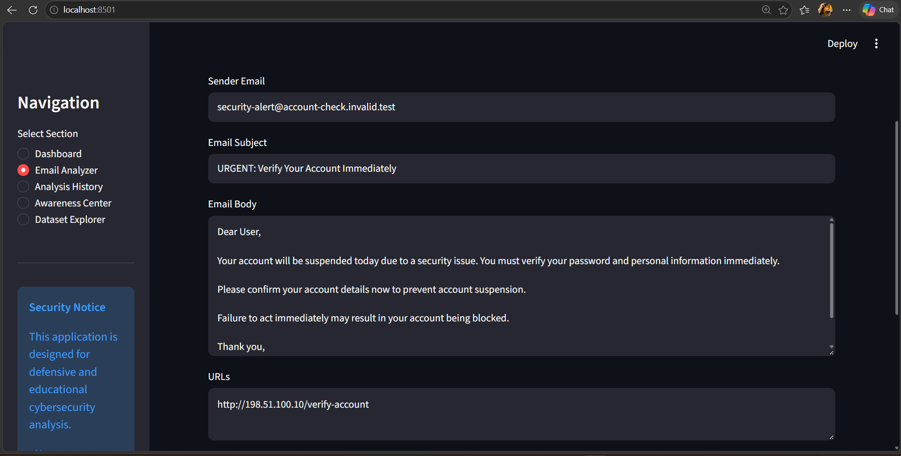

## 2. Email Classification Analytics

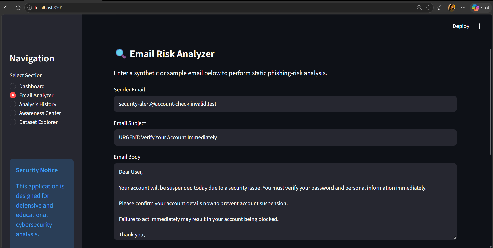

## 3. Email Analyzer

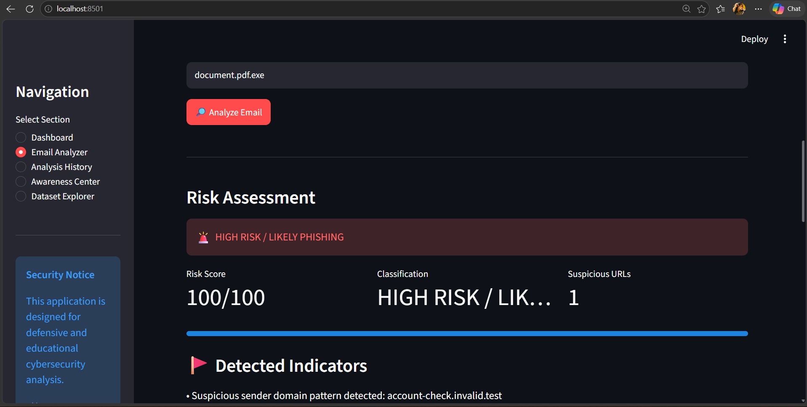

## 4. High-Risk Phishing Analysis

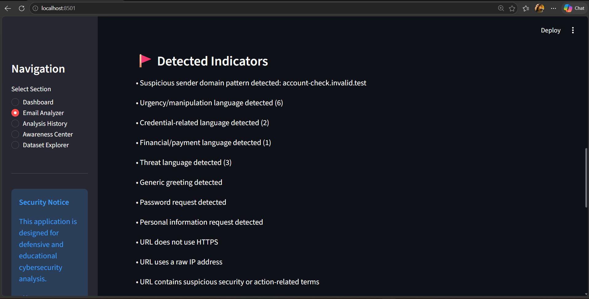

## 5. Detected Phishing Indicators

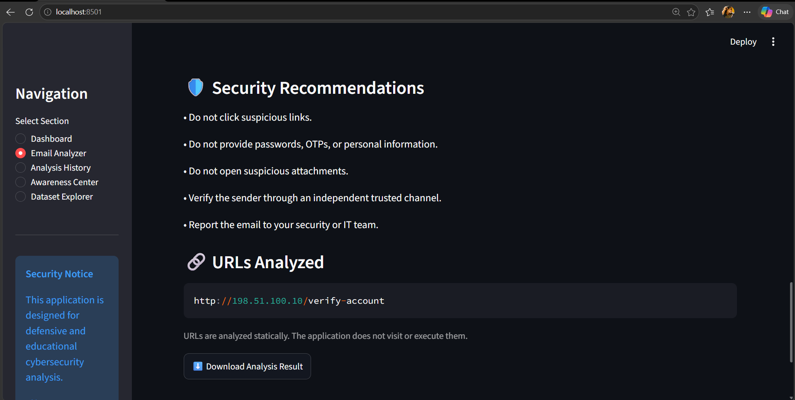

## 6. Security Recommendations

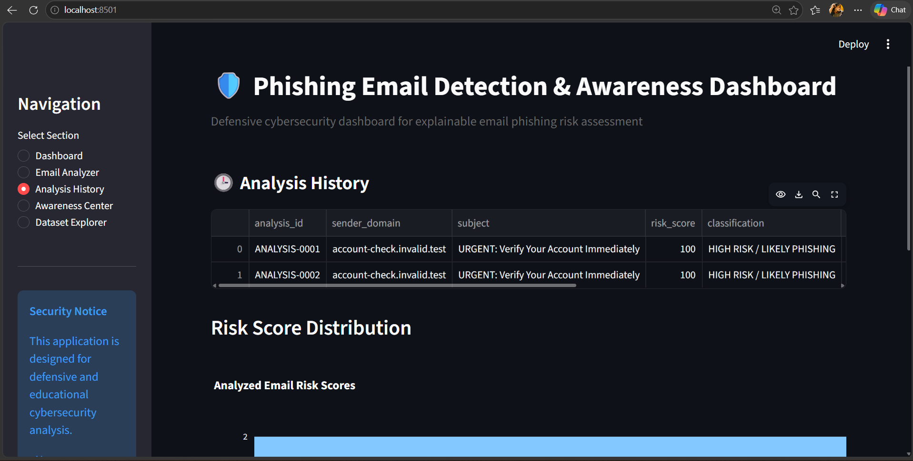

## 7. URL Analysis

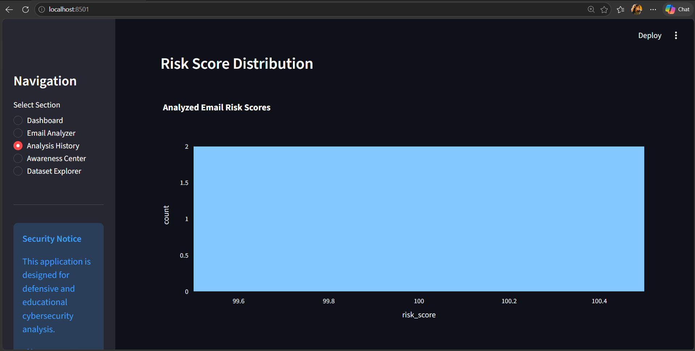

## 8. Analysis History

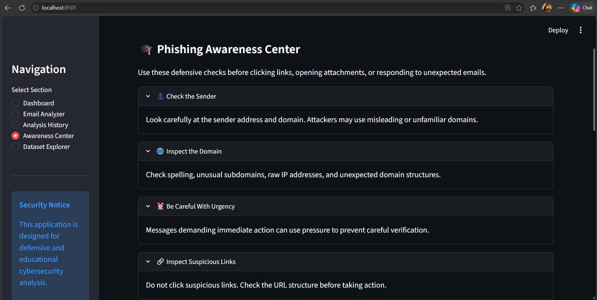

## 9. Risk Score Visualization

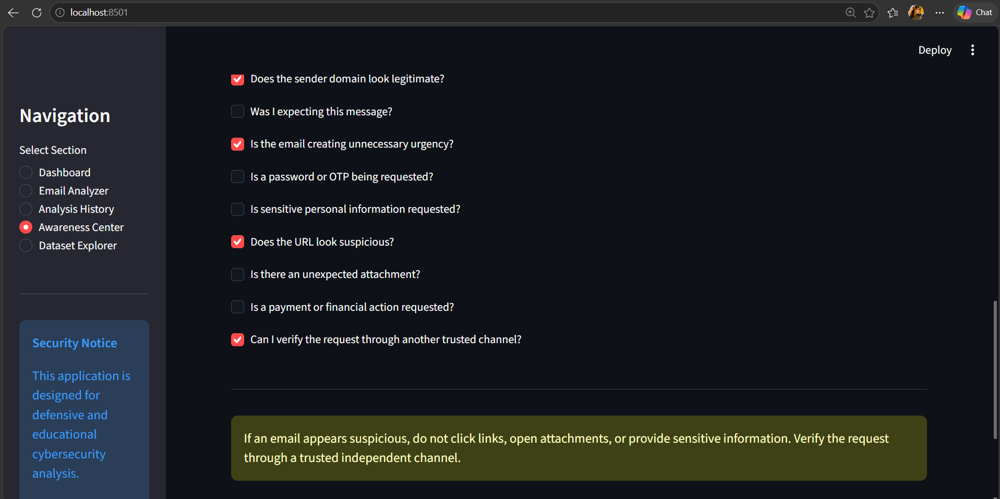

## 10. Phishing Awareness Center

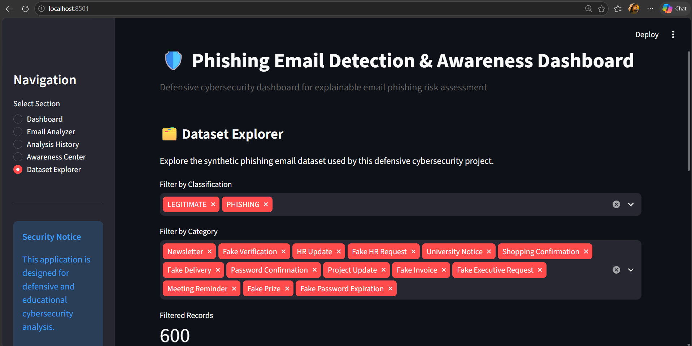

## 11. Before You Click Checklist

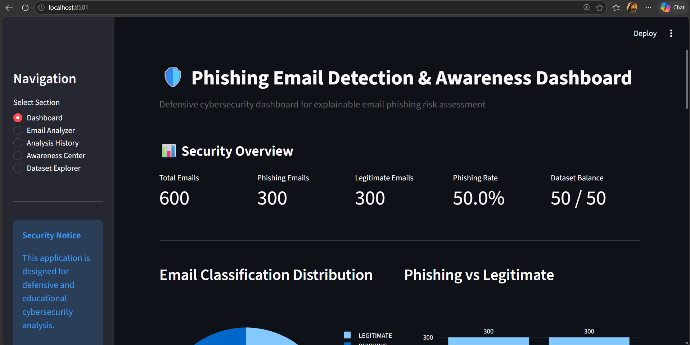

## 12. Dataset Explorer

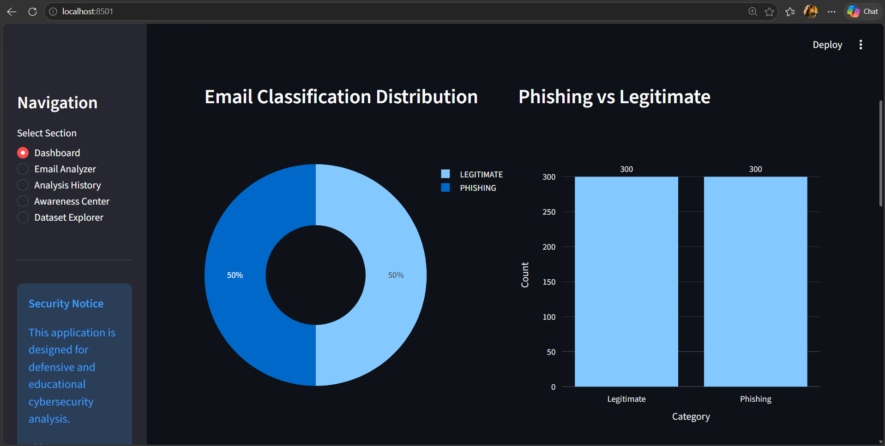

---

# 🔐 Security & Privacy

This project follows defensive cybersecurity principles.

### The application does NOT:

* Visit suspicious URLs
* Execute email attachments
* Collect passwords
* Collect OTPs
* Harvest credentials
* Perform phishing attacks
* Send phishing emails
* Perform offensive security operations

### Defensive Controls

The application uses:

* Static URL analysis
* Synthetic datasets
* Local processing
* Explainable security indicators
* Attachment filename analysis
* Input validation through application logic
* Local analysis history

---

# ⚠️ False Positives & False Negatives

Phishing detection is not perfect.

A legitimate email may contain:

* Urgency
* Payment terminology
* Security terminology
* Login-related language

Similarly, sophisticated phishing emails may avoid obvious indicators.

Therefore, the risk score should be treated as a **security-assistance signal**, not absolute proof of maliciousness.

Users should verify suspicious requests through trusted independent channels.

---

# 🚧 Limitations

Current limitations include:

* Rule-based detection rather than production-grade enterprise email intelligence
* Synthetic dataset
* Static URL analysis
* No live threat-intelligence feeds
* No real-time mail-server integration
* No attachment content execution or malware sandboxing
* No production authentication system
* No enterprise SIEM integration

---

# 🔮 Future Improvements

Potential future extensions include:

* TF-IDF + Logistic Regression phishing classifier
* Naive Bayes classification
* Random Forest model
* Larger real-world anonymized datasets
* Email header analysis
* Domain reputation intelligence
* DNS-based analysis
* Threat-intelligence integration
* Advanced NLP models
* Enterprise SIEM integration
* Real-time email-security monitoring
* Role-based security dashboards
* Production database deployment

---

# 💼 Cybersecurity Relevance

This project demonstrates practical concepts related to:

* Phishing Detection
* Email Security
* Social Engineering Detection
* Cybersecurity Awareness
* Threat Detection
* Security Analytics
* URL Analysis
* Risk Scoring
* SOC Concepts
* Defensive Security
* Secure Coding
* Explainable Security Analysis
* Python Security Automation

---

# 📚 Learning Outcomes

Through this project, the following skills were demonstrated:

* Python application development
* Streamlit dashboard development
* Pandas data processing
* Interactive data visualization
* Security indicator engineering
* Rule-based threat detection
* URL analysis
* Email content analysis
* Attachment analysis
* Risk scoring
* Explainable cybersecurity analysis
* SQLite database integration
* Automated testing with Pytest
* Git/GitHub project management

---

# 📌 Example Defensive Scenario

### Suspicious Email

```text
Sender:
security-alert@account-check.invalid.test

Subject:
URGENT: Verify Your Account Immediately

URL:
http://198.51.100.10/verify-account

Attachment:
document.pdf.exe
```

The system identifies multiple indicators including:

* Suspicious sender domain
* Urgency language
* Credential-related language
* Threat language
* Password request
* Personal information request
* Non-HTTPS URL
* Raw IP address
* Suspicious URL
* Dangerous attachment
* Double file extension

The resulting assessment is:

```text
Risk Score: 100/100

Classification:
HIGH RISK / LIKELY PHISHING
```

---

# 👩‍💻 Author

**Sai Hema**

BTech Computer Science Engineering | AI/ML & Cybersecurity Enthusiast

Areas of interest:

```text
Artificial Intelligence
Machine Learning
Cybersecurity
Data Science
Python
Full Stack Development
Security Analytics
```

---

# 🙏 Acknowledgement

Special thanks to **Umesh Yadav Sir** for his mentorship, guidance, encouragement, and continuous support in developing technical projects and building professional skills.

---

# ⚖️ Disclaimer

This project is intended **only for educational, research, and defensive cybersecurity purposes**.

All email examples, domains, URLs, and datasets used in this project are synthetic or fictional and are intended for safe demonstration.

Do not use this project to conduct phishing, credential harvesting, unauthorized access, malware distribution, or any other harmful activity.

---

## ⭐ Project Summary

**Phishing Email Detection & Awareness Dashboard** is a defensive cybersecurity application that combines explainable phishing-risk analysis, sender inspection, email-content analysis, URL inspection, attachment analysis, interactive security analytics, analysis history, and cybersecurity awareness education in a single Streamlit application.

**Built with Python • Streamlit • Pandas • Plotly • SQLite • Pytest**
